# Heliolune

**Sun, Moon & Seasons for the Omarchy bar.**

*Helio*, sun + *lune*, moon. Heliolune puts the sky on your bar: where the Sun and Moon are now, when they rise and set, how the light will change tonight, and where the year is heading. Everything is computed offline, checked against the US Naval Observatory, and drawn in one of three period themes.

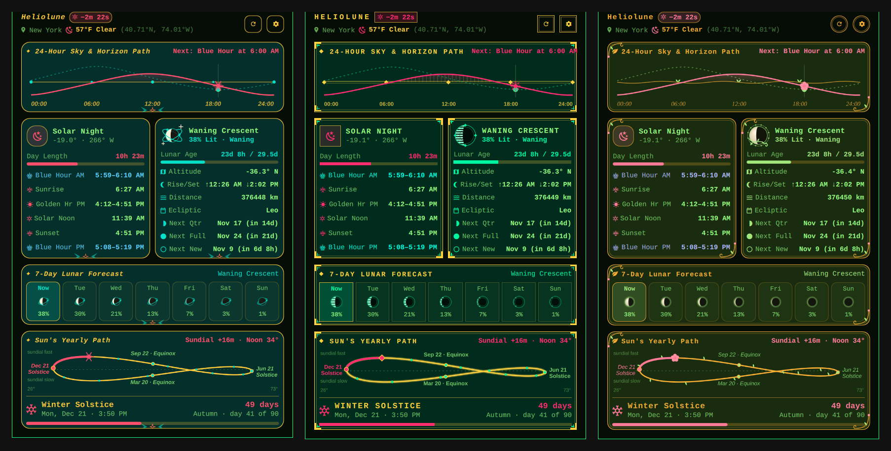

```bash
omarchy plugin add https://github.com/makehasteslowly/omarchy-heliolune.git --enable
```

---

## Why Heliolune

There are good moon widgets and good sunrise widgets for Omarchy. Heliolune is one instrument for both, plus the seasons that connect them.

- **The Sun's yearly figure-8.** The *analemma*, computed for your latitude: today's Sun on the curve, the equinoxes and solstices, and the path to the next one. Drag along it to travel through the year.
- **Three themes that restyle everything.** Not just colors: the Moon itself, the cards, buttons, dividers and sky chart change shape. Each has a Soft and a Bold intensity, and adapts its colors to stay readable on light Omarchy themes.
- **Measured accuracy.** Sunrise, sunset, moonrise and moonset agree with the US Naval Observatory to within a minute, from the equator to the Arctic. The test suite ships in the repo.
- **Zero setup, no dependencies.** It finds your location from Omarchy Weather, your IP or your time zone. Pure QML and JavaScript: no Python, no API keys, no accounts.

---

## A tour

### On the bar

The Sun, the Moon and the weather share one themed capsule (here with values; Atomic, Art Deco and Art Nouveau from top to bottom, Soft on the left and Bold on the right):

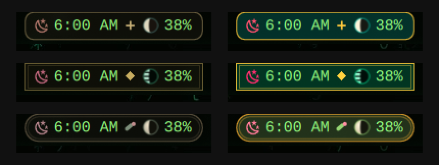

Pick what it shows in settings, under **Bar**:

- **Show:** Sun, Moon and Weather, each on or off (at least one stays on).
- **Details:** *Icons only*, or *With values*: an arrow and the time of the Sun's next event (hover to see which), the Moon's illumination and the temperature.
- **Scrolling:** *Weather alerts* and *Sky reminders*, each on or off. **Test alert** scrolls a sample of each across the bar once, so you can see how they look without waiting for a storm.

Every icon shows what is happening **now**: the Sun's is the sky's current phase (day, golden hour, blue hour, twilight or night), the Moon's its current phase. The weather icon is line-drawn in the theme's metal tone, so it never looks like one of the sky icons beside it.

**Hover and click:** every point on the capsule belongs to its nearest item (Sun, Moon or weather), so the highlight, the tooltip and a click always agree. Hovering lights that item; its tooltip says what it shows and which view a click opens. Click to open that view, click the same item again to close it, or another item to switch. The capsule itself lights up while a view is open, and the clicked item glows briefly. Right-click opens settings, middle-click refreshes.

**Sky light.** The capsule and the popup carry the light of the sky outside: warm gold at golden hour, blue at blue hour, a faint cool tint at night, and nothing at midday. When a new phase begins, a soft band of its light sweeps once across the capsule. The popup follows the date you are viewing, so stepping to an evening shows that evening's light. Turn it off under **Settings → Appearance → Sky light**; `omarchy-shell makehasteslowly.heliolune testSky` plays a whole evening in 16 seconds.

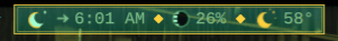

**Alerts on the bar.** Severe weather and sky reminders (golden hour, full moon, season changes) scroll across the bar instead of popping up as notifications: weather warnings in red, reminders in the theme's metal. **Settings → Bar → Test alert** plays a sample.

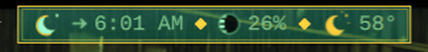

With weather on, the capsule also shows the current conditions as a small line-drawn icon and the temperature. Hover for a summary including the next moonrise or moonset and the full weather reading.

### In the popup

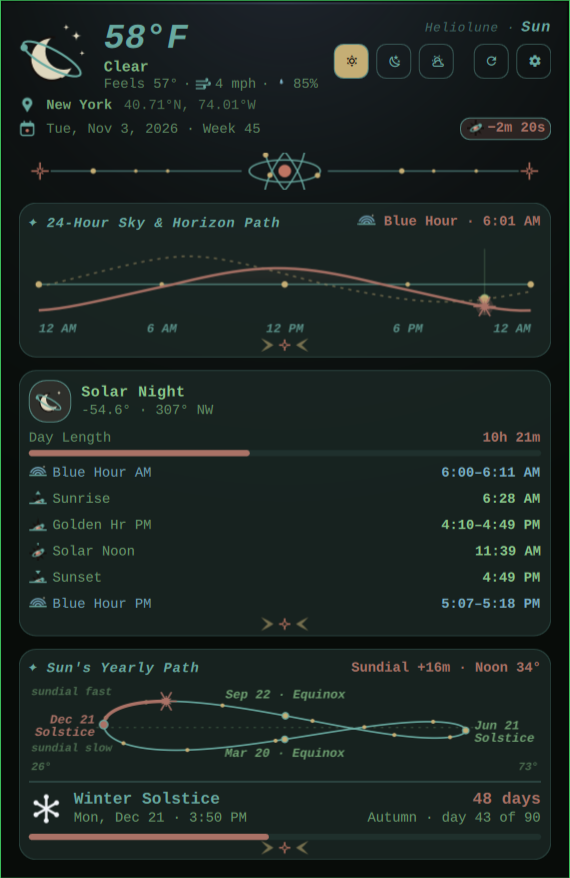

Each item on the bar opens its own view. The header shows the same three in the same order, **Sun · Moon · Weather**, with the one on screen highlighted, then **Refresh** and **Settings**; **M** and **W** switch too.

- **Header (every view):** the **current weather**: a large line-drawn icon for the conditions, the temperature, the sky, and feels-like, wind and humidity (optional, see [Privacy](#privacy--network)). Below it, your city and coordinates, the **date and week number** (e.g. `Mon, Nov 2, 2026 · Week 45`), and the daylight gained or lost since yesterday. During severe weather an alert banner sits under it.
- **Sun** (click the sun, or anywhere else on the capsule):
  - **24-hour sky path:** the Sun's and Moon's altitude through the day against your horizon, and where they are right now.
  - **The Sun:** sky phase (from astronomical night through blue hour, golden hour and solar noon), altitude and compass bearing, day length, and the day's timetable: blue hour, sunrise, golden hour, solar noon, sunset, blue hour.
  - **The Sun's yearly path:** the analemma, then the countdown to the next equinox or solstice with the current season's progress (*Autumn · day 41 of 90*). Hemisphere-aware: in Sydney, June brings the Winter Solstice.
- **Moon** (click the moon): opens on **Cycle**: the current lunation from the last new Moon to the next, with today's Moon large and marked on a track with the quarters and the full Moon. Press play for a **time lapse** through the cycle, or switch to **Sky** to watch the Moon (and the Sun) cross a compass horizon over the next 24 hours; scrub, pause, or jump back to **Now**. Below it, the Moon card: phase, illumination, age, moonrise and moonset, altitude, distance, ecliptic sign, the next quarter, full and new Moon. Then **Today** (when the Moon is up in a dark sky, hour by hour, with the weather's clouds taken into account), **7 Days** (a row per day: phase, moonrise, illumination) and **30 Days** (a month of Moons with the new, quarter and full Moons marked).
- **Weather** (click the weather): **Today** (the next 24 hours, every three hours, with chance of rain), **3 Days** (conditions, high and low, rain chance, wind per day) **7 Days** (one row per day with the week's temperature range) or **Map** (a 5 × 5 grid of forecast points around you, out to 20, 60 or 100 miles (30, 100 or 160 km in metric), showing **Temp**, **Rain** (real radar for the past two hours from RainViewer, then the forecast as a radar-style picture, with bars on the timeline showing when rain comes) or **Wind** (streaks flowing the way the wind blows, brighter where it is stronger; they also drift faintly over the rain); drag the hour bar or press play to watch the next 24 hours move across the area, and hover a square for its distance, direction and conditions). The squares sit on an OpenStreetMap map of the area (towns, roads, rivers), muted to suit the theme; north is up and the middle square is your location.

| Moon | Forecast | Map |
|---|---|---|
| 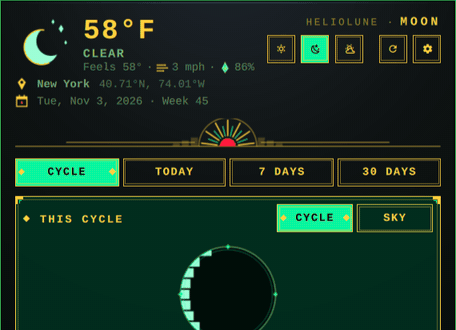 | 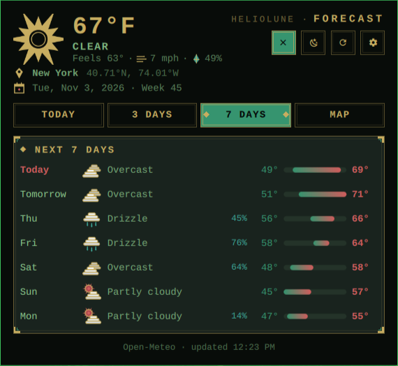 | 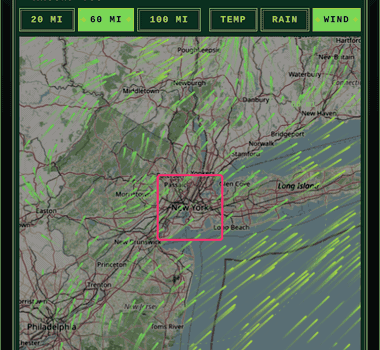 |

Any card can be hidden in settings, under **View Cards**.

### Time travel

Look at any date up to ten years either way, and every card follows.

- **Drag or click the figure-8** to jump to that day of the year. Where the two loops cross, the drag stays on the loop you are on.
- **Scroll over it** to step a day at a time (Shift: a week), or use **← / →**, and **T** for today.
- A *Viewing …* chip shows the date you are on. Closing the popup always returns to live.

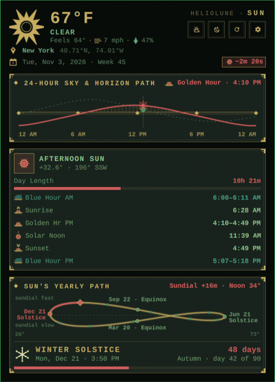

---

## Themes

Right-click the widget and pick a **Style**: the choice restyles the whole widget. They are listed in the order of their eras: Art Nouveau (1890s–1910s), Art Deco (1920s–30s) and Atomic (1940s–50s).


| | Art Nouveau | Art Deco | Atomic (default) |
|---|---|---|---|
| **The Moon** | Softly shaded disc in a beaded halo, with a vine and leaves | Streamline bands with a stepped terminator, double rim and diamond studs | Flat poster disc circled by orbiting electrons |
| **Palette** | *Mucha Botanical:* sage, amber, dusty rose, bronze, cream | *Emerald & Ruby:* emerald, ruby red, gold on onyx | *Atomic Age:* teal, atomic orange, mustard, cream on walnut |
| **Ornament** | Halo-and-blossom crest, vine dividers, curling corner tendrils, pill buttons | Sunburst crest, gilded double frames, ziggurat steps, spaced capitals | Starbursts, boomerangs, atom dots, rounded tabs |
| **Weather icons** | Organic forms: flame-ray sun, scroll-curl clouds, teardrops, blossom snowflakes | Stepped gilded geometry: sunburst-fan sun, ziggurat clouds, straight rain, diamond snow | Flat poster shapes: starburst sun, bold-outlined clouds, teardrop rain, sparkle snow |

**Celestial Colors** sets the intensity:

- **Soft:** muted, printed tones and a light hand with the ornament.
- **Bold:** full-saturation color, heavy rules and deep jewel-toned cards.
- **Theme:** keeps the theme's shapes but takes its colors from your Omarchy theme.

| Atomic | Art Deco | Art Nouveau |
|---|---|---|
|  | 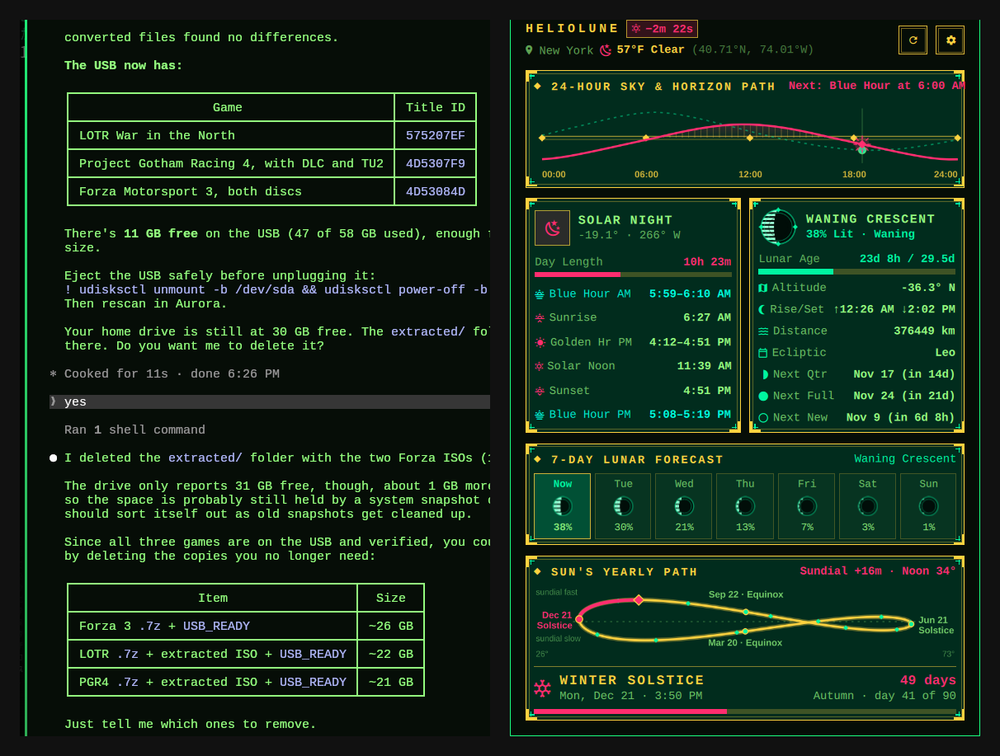 | 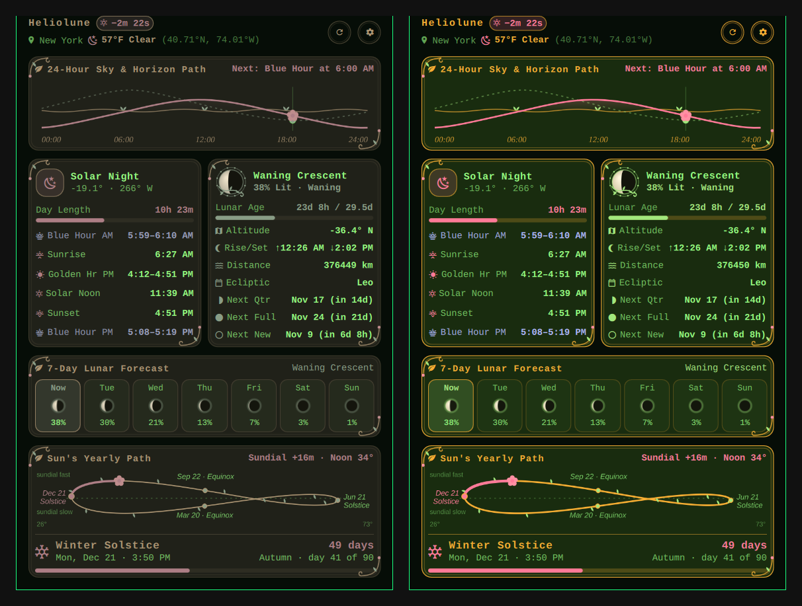 |

On light themes, every color is checked against the actual bar and popup background and darkened until it meets WCAG contrast (4.5:1 for text), so nothing washes out.

---

## Install

Requires **Omarchy 4** or newer (the Quickshell shell). Tested on Omarchy 4.5.

```bash
omarchy plugin add https://github.com/makehasteslowly/omarchy-heliolune.git --enable
```

Move it to another part of the bar:

```bash
omarchy bar move makehasteslowly.heliolune --section right
```

Update or remove:

```bash
omarchy plugin update makehasteslowly.heliolune
omarchy plugin remove makehasteslowly.heliolune
```

> Omarchy plugins run unsandboxed inside the shell. Read the code before enabling any plugin, this one included. The widget itself is two files, `BarWidget.qml` and `Model.js`.

---

## Controls

| | |
|---|---|
| **Left-click** | On the sun, the moon or the weather: its view (click again to close) |
| **Right-click** | Open settings |
| **Middle-click** | Refresh location, weather and astronomy |
| **← / →** | Previous / next day (Shift: a week) |
| **T** | Back to today |
| **M** / **W** | The Moon view / the Weather view (press again to go back to the Sun view) |
| **S** / **R** | Settings / refresh |
| **↑ ↓ PgUp PgDn Home** | Scroll |
| **Esc** | Close (from the Moon or Weather view: back to the Sun view) |
| **1 / 2 / 3** (in settings) | Art Nouveau / Art Deco / Atomic |
| **1 / 2 / 3 / 4** or **← / →** (in the Moon view) | Cycle / Today / 7 Days / 30 Days |
| **1 / 2 / 3 / 4** or **← / →** (in the Weather view) | Today / 3 Days / 7 Days / Map |
| **Space** (on Cycle) | Play / pause the time lapse |

From a script or keybinding:

```bash
omarchy-shell makehasteslowly.heliolune toggle   # also: open, close, refresh
omarchy-shell makehasteslowly.heliolune stepDays 7   # time travel: +/- n days
omarchy-shell makehasteslowly.heliolune today
omarchy-shell makehasteslowly.heliolune sun        # the Sun view
omarchy-shell makehasteslowly.heliolune moon       # the Moon view
omarchy-shell makehasteslowly.heliolune weather    # the Weather view
omarchy-shell makehasteslowly.heliolune testAlert  # scroll a sample weather alert and sky reminder
omarchy-shell makehasteslowly.heliolune testSky    # watch a whole evening of sky light in 16 seconds
```

---

## Settings

Everything is in the right-click panel, in foldable sections: **Location** (search for a city), **Appearance**, **Bar**, **Weather**, **View Cards**, **Calendar**, **Sky Reminders** and **Advanced**. Click a section's heading to fold or unfold it.

<p align="center">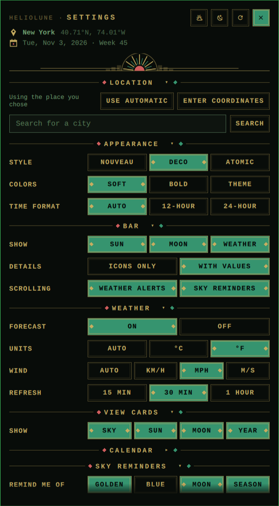</p>

The same keys can be set on the widget's entry in `~/.config/omarchy/shell.json`:

| Key | Values | Default |
|---|---|---|
| `barSun`, `barMoon` | `on` · `off`: the Sun and the Moon on the bar | `on` |
| `barDetails` | `icons` · `values` (next Sun event time, Moon %, temperature) | `values` |
| `moonStyle` | `nouveau` · `deco` · `atomic` | `atomic` |
| `colorMode` | `celestial` (Soft) · `bold` · `theme` | `celestial` |
| `timeFormat` | `auto` · `12` · `24` | `auto` |
| `skyLight` | `on` · `off`: the bar capsule and the popup glow with the color of the sky (gold at golden hour, blue at blue hour, moonlight at night); when a new phase begins, a soft band of its light sweeps once across the capsule | `on` |
| `weather` | `auto` (°F for US locales, °C elsewhere) · `c` · `f` · `off` | `auto` |
| `barWeather` | `on` · `off`: the themed weather icon and temperature on the bar | `on` |
| `windUnit` | `auto` (mph with °F, km/h otherwise) · `kmh` · `mph` · `ms` | `auto` |
| `weatherRefresh` | `15` · `30` · `60` minutes | `30` |
| `weatherAlerts` | `on` · `off`: heavy rain, freezing rain, heavy snow, thunderstorms or hail now or within 12 hours scroll across the bar (from the same forecast; not an official warning service) | `on` |
| `cardSky`, `cardSun`, `cardYear` (Sun view), `cardMoon` (Moon view) | `on` · `off`: show or hide each card | `on` |
| `weekScheme` | `auto` (from locale) · `iso` · `us` | `auto` |
| `seasons` | `astronomical` · `meteorological` | `astronomical` |
| `lightPreset` | `standard` · `photographer` · `extended` golden/blue-hour windows | `standard` |
| `elevation` | Your height above sea level in meters (0-9000); the settings field shows feet with imperial units | `0` |
| `notify` | `on` · `off`: sky reminders scrolling on the bar (see below) | `on` |
| `notifyDesktop` | `on` · `off`: also send each reminder as a desktop notification | `off` |
| `notifyGolden`, `notifyBlue` | `on` · `off`: remind before golden hour / blue hour begins | `on`, `off` |
| `notifyMoon`, `notifySeason` | `on` · `off`: remind of full and new moons / the next equinox, solstice or season start | `on` |
| `notifyMornings` | `on` · `off`: morning golden and blue hours too, not only the evening ones | `off` |
| `notifyLead` | `0` · `10` · `30` minutes before golden or blue hour begins | `10` |
| `latitude`, `longitude`, `locationName` | Manual location override (set by **Search for a city** or **Enter coordinates**) | empty (automatic) |

```json
{ "id": "makehasteslowly.heliolune", "moonStyle": "deco", "colorMode": "bold", "barDetails": "icons" }
```

**Location.** Heliolune follows Omarchy Weather's location, then your approximate location, then your time zone. To pick a place yourself, type its name under **Settings → Location → Search for a city**, press **Search** (or Enter) and click the right match; it is saved as `latitude`, `longitude` and `locationName`. **Enter coordinates** takes coordinates directly, and **Use automatic** goes back to the automatic location.

**Sky reminders** scroll across the bar widget the same way weather alerts do (both switch on and off under **Settings → Bar → Scrolling**; the reminder options appear in **Sky Reminders** below while they are on), in the theme's metal tone (gold in Art Deco; weather alerts keep the urgent red), and they also appear in the widget's tooltip:

- **Golden** and **Blue:** from shortly before the evening golden or blue hour begins until 15 minutes after (the morning ones too with **Golden & blue → Both**). **Lead time** sets how early: at start, 10 or 30 minutes.
- **Moon:** full moon and new moon, from 09:00 on the day, or from 18:00 the evening before when the moment falls in the morning.
- **Season:** the next equinox or solstice (or 1 March, June, September or December with meteorological seasons), timed like the Moon.

**Desktop alerts → On** also sends each reminder once as a desktop notification (through `notify-send`). Notifications missed while the computer was asleep are dropped, not sent late. **Test** scrolls a sample across the bar that names the next reminder.

---

## Accuracy

All astronomy runs locally in `Model.js`:

- **Sun:** Meeus ch. 25, with nutation and aberration.
- **Moon:** the main periodic terms of Meeus ch. 47.
- **Time:** IAU sidereal time and ΔT.
- **Events:** rise, set and transit times are solved iteratively at the event itself.

An offline test suite compares Heliolune with the **US Naval Observatory**. It covers six cities from the equator to the Arctic (Greenwich, New York, Sydney, Singapore, Reykjavik and Tromsø), including polar day, polar night and days when the Moon rises twice.

| Quantity | Comparisons | Max error vs USNO |
|---|---|---|
| Sunrise / sunset | 186 | 0.1 min |
| Civil twilight | 178 | 0.1 min |
| Solar noon | 94 | < 0.1 min |
| Moonrise / moonset | 181 | 0.3 min |
| Equation of time (the analemma) | 94 | < 0.1 min |
| Moon phases, 2025–2027 | 148 | 1.4 min (mean 0.2) |
| Equinoxes & solstices, 2024–2030 | 28 | 0.6 min |

USNO publishes times to the minute; errors are measured after allowing for that rounding.

```bash
node tests/accuracy.mjs            # summary; exits non-zero on any regression
node tests/accuracy.mjs --verbose  # every comparison
node tests/calendar.mjs            # week numbers, options, weather, map, city search, reminders
node tests/strings.mjs             # every string the code names exists in i18n/en.json
python3 -I tests/fetch-usno.py     # refresh the reference data (public test cities only)
```

---

## Privacy & network

Every request goes over HTTPS, is size-capped, and is validated before use:

| What | Where | When | Turn it off |
|---|---|---|---|
| **Your approximate location**, only if Omarchy Weather has no location and you set none | `geo.omarchy.org`, Omarchy's own geolocation service | At startup, then every 3 hours; cached for offline use | Set a location in Omarchy Weather or in Heliolune's settings |
| **Current weather and forecast** (one request) for your coordinates rounded to ~1 km | `api.open-meteo.com`, no account or key | At startup, every 30 minutes (15/30/60 in settings), and when your location changes | Set **Forecast** to **Off** (Settings → Weather) |
| **Area map forecast** (one request) for 25 points around your coordinates, out to the chosen radius, each rounded to ~1 km | `api.open-meteo.com`, no account or key | Only while the **Map** tab is open: once when you open it or change the radius, then at most once per refresh interval | Don't open the Map tab, or set **Forecast** to **Off** |
| **Map tiles** (OpenStreetMap's standard map, 4 to 16 images of 256 px) for the area shown | `tile.openstreetmap.org`, sent with Heliolune's own User-Agent as the [OSM tile policy](https://operations.osmfoundation.org/policies/tiles/) asks | Only while the **Map** tab is open, and only tiles not already cached; each is kept 7 days in `~/.cache/heliolune/osm-tiles` (deleted after 30) | Don't open the Map tab |
| **City search**: the place name you typed (cleaned, at most 60 characters), nothing else | `geocoding-api.open-meteo.com`, no account or key | Only when you press **Search** in Settings → Location | Don't use the search; enter coordinates with **Enter coordinates** instead |
| **Rain radar** (the list of the last ~2 hours of frames, then up to 4 radar images per frame for the area shown) | `api.rainviewer.com` and `tilecache.rainviewer.com`, no account or key (free for personal use), sent with Heliolune's User-Agent | Only while the Map tab shows **Rain**: the frame list at most every 5 minutes, and only images not already cached; kept 3 hours in `~/.cache/heliolune/radar` | Don't pick **Rain** on the Map tab |

With a location set and weather off, Heliolune makes no network requests at all. All astronomy is computed on your machine, and nothing else is sent anywhere. Sky reminders are local too: they are computed on your machine, and the optional desktop notifications go through your own notification daemon.

Omarchy does not share its weather with other plugins, which is why Heliolune fetches its own from the same provider.

---

## See also

Other sky widgets for Omarchy, each good at its own thing:

- [**Moonshot**](https://github.com/rodrix2000/omarchy-moonshot): a deep Moon companion with a lunar calendar, eclipse tracking and saved places.
- [**omarchy-sun**](https://github.com/steveclarke/omarchy-sun): a minimal sunrise/sunset widget.
- [**Moon Arc**](https://github.com/rookepoole/omarchy-moon-arc) and [**Moon Phase**](https://github.com/jeffmtb/omarchy-moon-phase): light, location-free moon phase indicators.
- [**Âm lịch**](https://github.com/hoojiNT/omarchy-lunar-calendar): the Vietnamese lunar calendar.

## Credits

- Astronomy after Jean Meeus, *Astronomical Algorithms* (2nd ed.).
- Reference data from the [US Naval Observatory Astronomical Applications API](https://aa.usno.navy.mil/data/api).
- Weather by [Open-Meteo](https://open-meteo.com/).
- Map data © [OpenStreetMap contributors](https://www.openstreetmap.org/copyright), tiles from the OpenStreetMap Foundation.
- Rain radar by [RainViewer](https://www.rainviewer.com/).
- Built for [Omarchy](https://omarchy.org/).

## License

[MIT](LICENSE) © 2026 makehasteslowly
